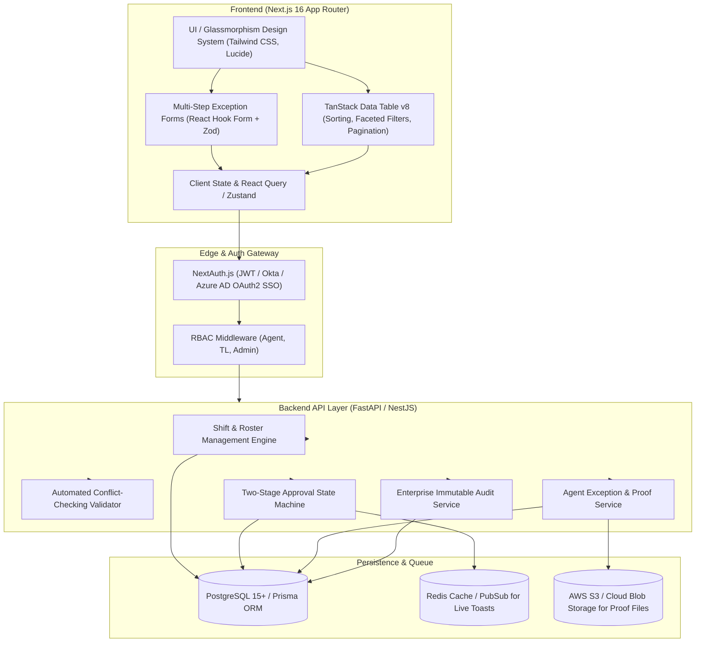

# Enterprise Attendance & Workforce Management System (AMS)
## Next-Gen Architecture & System Design Specification

### 1. Architectural Overview & System Context

The modernized Attendance & Workforce Management System (AMS) transforms legacy table-heavy, dropdown-cluttered attendance tools into a real-time, event-driven web platform. It pairs Next.js 16 (App Router, Turbopack, React 19) with a modular backend API layer (FastAPI / NestJS) and PostgreSQL / Prisma persistence.



---

### 2. Core Functional Modules & User Experience Modernization

#### 2.1. Authentication & Role-Based Dashboard
- **Glassmorphic SaaS Canvas**: Deep obsidian dark palette (`#090d16`) with high-contrast text and luminous status tokens.
- **Dynamic Profile Banner**: Real-time display of Agent ID (`AGT-8042`), Squad/Department, live shift status badge (`ON_SHIFT`, `ON_BREAK`, `OFF_SHIFT`, `EXCUSED`), and live alert ticker for pending reviews.
- **Role Persona Switcher**: Instant switching between `AGENT`, `TEAM_LEADER`, and `ADMIN` profiles.

#### 2.2. Intelligent Shift Swap Engine (Replacing Legacy Dropdowns)
- **Searchable Colleague Combobox**: Real-time filtered autocomplete searching across Agent Name, Agent ID, Squad, and Department (eliminates massive 500+ item raw select tags).
- **Automated Conflict-Checking Engine**:
  1. *Double-Booking Guard*: Verifies neither requester nor peer has an overlapping working shift.
  2. *11-Hour Minimum Turnaround Guard*: Enforces statutory rest periods between consecutive shifts.
  3. *Off-Day Parity Rule*: Prevents invalid swaps (e.g., swapping an Off Day for an Off Day).
  4. *Consecutive Days Warning*: Alerts when an exchange results in > 6 consecutive shifts without a rest day.
- **Two-Stage Governance Pipeline**:
  - `[Stage 1: Peer Acceptance]`: Requester initiates swap $\rightarrow$ Target Peer accepts or declines.
  - `[Stage 2: TL Clearance]`: Upon peer acceptance, routes to Team Leader for roster authorization $\rightarrow$ Master schedule committed.

#### 2.3. Agent Self-Excuse & Exception Logging System
- **Dynamic Multi-Step Form**:
  - Step 1: Category selection (`SYSTEM_FAILURE`, `LEARNING_TRAINING`, `MEETINGS`, `MISCELLANEOUS`, `HEALTH_EMERGENCY`) with contextual icons.
  - Step 2: Cascading subcategories (e.g., VPN drop, CRM Error 500, QA coaching, IVR telephony cut).
  - Step 3: Smart Duration Picker automatically calculating duration in minutes and hours from `FromTime` and `ToTime`.
  - Step 4: Incident ticket reference (`INC-94812`) and screenshot/proof attachment upload.
  - Full schema validation with Zod and React Hook Form.
- **Rich TanStack Data Table**:
  - Multi-column sort, global text search, category facet filters, status buttons (`ALL`, `PENDING`, `APPROVED`, `REJECTED`).
  - Subtle modern status tokens (emerald for approved, amber for pending, rose for rejected).
  - Supervisor inspection modal with one-click approve/reject actions and feedback notes.

---

### 3. REST API Specifications

#### 3.1. Authentication & User Profile
```http
POST /api/v1/auth/login
Content-Type: application/json

Request:
{
  "email": "alex.vance@enterprise-ams.com",
  "password": "string"
}

Response (200 OK):
{
  "token": "eyJhbGciOi...",
  "user": {
    "id": "u-101",
    "agentId": "AGT-8042",
    "name": "Alex Vance",
    "role": "AGENT",
    "department": "Tier 2 Technical Support",
    "shiftGroup": "Alpha APAC Squad",
    "currentShiftStatus": "ON_SHIFT"
  }
}
```

#### 3.2. Shift Swaps & Conflict Checking
```http
POST /api/v1/shifts/swaps/validate
Content-Type: application/json

Request:
{
  "requesterShiftId": "sh-101-5",
  "targetPeerId": "u-102",
  "targetShiftId": "sh-102-3"
}

Response (200 OK):
{
  "hasConflict": false,
  "errors": [],
  "warnings": ["Sarah Connor is picking up an extra working shift in exchange for their OFF_DAY."],
  "details": {
    "doubleBooking": false,
    "restPeriodViolation": false,
    "invalidShiftTypeSwap": false,
    "consecutiveDaysExceeded": false,
    "bothOffDays": false
  }
}
```

```http
POST /api/v1/shifts/swaps
Content-Type: application/json

Request:
{
  "requesterShiftId": "sh-101-5",
  "targetPeerId": "u-102",
  "targetShiftId": "sh-102-3",
  "swapReason": "Need afternoon slot to attend medical specialist in morning."
}

Response (201 Created):
{
  "id": "sw-901",
  "status": "PENDING_PEER",
  "createdAt": "2026-10-14T08:00:00Z"
}
```

```http
PATCH /api/v1/shifts/swaps/{id}/peer-decision
Content-Type: application/json

Request:
{
  "action": "ACCEPT", // "ACCEPT" | "DECLINE"
  "peerResponseNotes": "Happy to swap! Morning schedule suits my evening class."
}

Response (200 OK):
{
  "id": "sw-901",
  "status": "PEER_ACCEPTED",
  "updatedAt": "2026-10-14T08:30:00Z"
}
```

```http
PATCH /api/v1/shifts/swaps/{id}/tl-decision
Content-Type: application/json

Request:
{
  "action": "APPROVE", // "APPROVE" | "REJECT"
  "tlNotes": "Coverage verified for APAC Tier 2. Approved."
}

Response (200 OK):
{
  "id": "sw-901",
  "status": "APPROVED_BY_TL",
  "rosterUpdated": true,
  "updatedAt": "2026-10-14T09:00:00Z"
}
```

#### 3.3. Self-Excuse & Exception Logging
```http
POST /api/v1/excuses
Content-Type: application/json

Request:
{
  "category": "SYSTEM_FAILURE",
  "subCategory": "CSP / CRM Application 500 Error",
  "fromTime": "2026-10-14T08:15:00Z",
  "toTime": "2026-10-14T08:50:00Z",
  "durationMinutes": 35,
  "reason": "Production Salesforce CRM returned gateway timeout on customer ticket query.",
  "ticketNumber": "INC-94812",
  "attachmentUrl": "https://storage.ams.enterprise/proofs/crm_error.png"
}

Response (201 Created):
{
  "id": "exc-701",
  "status": "PENDING",
  "durationMinutes": 35,
  "createdAt": "2026-10-14T08:55:00Z"
}
```

```http
PATCH /api/v1/excuses/{id}/review
Content-Type: application/json

Request:
{
  "status": "APPROVED", // "APPROVED" | "REJECTED" | "NEEDS_INFO"
  "feedback": "IT confirmed widespread softphone patch bug. Excused."
}

Response (200 OK):
{
  "id": "exc-701",
  "status": "APPROVED",
  "reviewedAt": "2026-10-14T10:00:00Z"
}
```

---

### 4. Role-Based Access Control (RBAC) Matrix

| Capability / Action | AGENT | TEAM_LEADER | ADMIN |
|---|:---:|:---:|:---:|
| View Personal Shifts & Calendar | ✓ | ✓ | ✓ |
| View Squad Master Roster | Read-Only | ✓ | ✓ |
| Initiate Shift Swap Request | ✓ | ✓ | ✓ |
| Accept / Decline Peer Shift Swap | ✓ (As Peer) | ✓ | ✓ |
| Authorize Stage 2 Shift Swap (Commit to Roster) | ✗ | ✓ | ✓ |
| Submit Self-Excuse / Exception Log | ✓ | ✓ | ✓ |
| Review / Adjudicate Agent Excuses | ✗ | ✓ | ✓ |
| Batch Approve Exceptions & Swaps | ✗ | ✓ | ✓ |
| Override System Conflict Checks | ✗ | ✗ | ✓ |
| View Compliance Audit Logs | Personal | Squad | Full Enterprise |

---

### 5. State Management & Real-Time Sync Architecture

1. **Client State**:
   - `Zustand` for global user session, active shift status, and UI drawer states.
   - `TanStack Query (React Query)` for cache invalidation on mutations (e.g., `['shifts']`, `['swaps']`, `['excuses']`).
2. **Optimistic Updates**:
   - Shift swap acceptance reflects immediately on the UI with rollback upon network failure.
3. **Event Notification (Server-Sent Events / WebSockets)**:
   - When a peer accepts a swap, an event is published to Redis pub/sub, pushing a real-time toast notification to the Team Leader.
